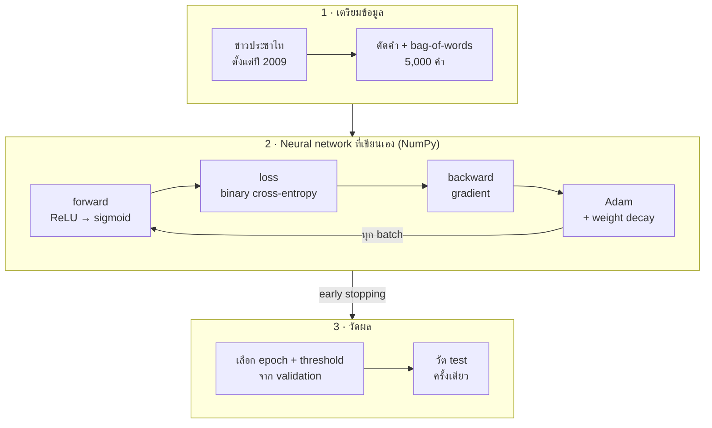
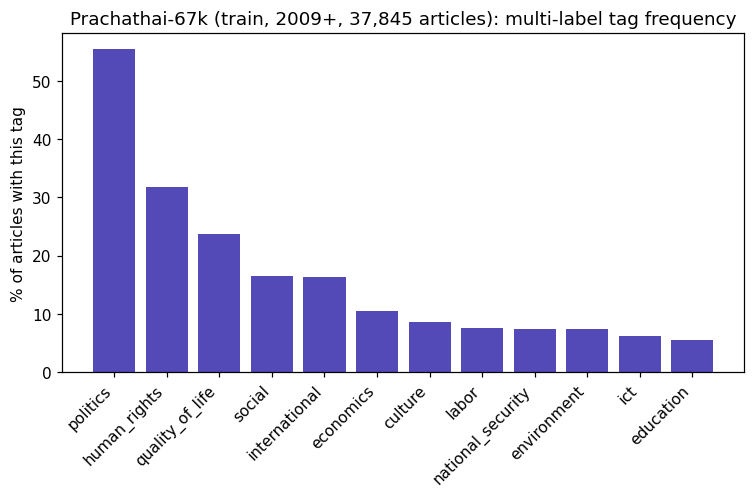
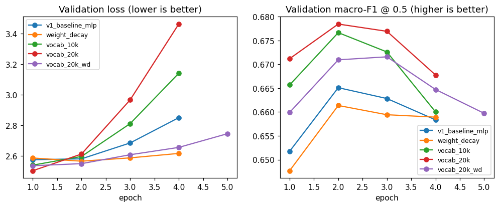

# Thai News MLP Classifier


**Neural network ที่เขียนเองด้วย NumPy · จัดหมวดข่าวไทย 12 แท็ก · test macro-F1 0.689** (baseline 0.262)

## ทำอะไร

- เขียน neural network (MLP) เองทุกส่วน ตั้งแต่ forward, loss, backward ไปจนถึง Adam ไม่ใช้ PyTorch หรือ scikit-learn
- ทดสอบกับข่าวไทยจริงจากประชาไท ให้ model ตัดสินว่าข่าวอยู่หมวดไหนบ้าง ข่าวหนึ่งชิ้นมีได้หลายหมวด (multi-label)
- **จุดประสงค์คือการเรียนรู้:** เอาทฤษฎี neural network มาเขียนเป็นโค้ด แล้วพิสูจน์กับข้อมูลจริงว่าเขียนถูกและวัดผลได้

## ตัวอย่างจริง

ข่าวจาก test set ซึ่ง model ไม่เคยเห็นระหว่างเทรน

**"เผยสายด่วน 1669 ช่วยผู้ประสบอุบัติเหตุรอดสูง"** (2014)
| แท็ก | p | ทาย | เฉลย |
|---|---|---|---|
| คุณภาพชีวิต | 0.97 | ✅ ใช่ | ✅ |
| สังคม | 0.62 | ✅ ใช่ | ✅ |
| ต่างประเทศ | 0.03 | ไม่ใช่ | |

**"ประมวลภาพ: รัชดาจ๋า... น้ำมาถึงแล้ว"** (2011, ข่าวน้ำท่วม)
| แท็ก | p | ทาย | เฉลย |
|---|---|---|---|
| คุณภาพชีวิต | 0.81 | ✅ ใช่ | ✅ |
| สังคม | 0.44 | ✅ ใช่ | ✅ |
| สิ่งแวดล้อม | 0.41 | ⚠️ ใช่ | ✗ |

ข่าวที่สองทายเกินมา 1 แท็ก ข่าวน้ำท่วมจะนับเป็นสิ่งแวดล้อมก็ฟังขึ้น แต่คนติดแท็กของประชาไทไม่ได้เลือกไว้ แท็กที่ขอบเขตไม่ชัดแบบนี้คือจุดที่ model พลาดบ่อยที่สุด

## Flow ของโปรเจค



## ผลลัพธ์

|                              | macro-F1  | micro-F1  |
| ---------------------------- | --------- | --------- |
| baseline (ทายทุกแท็กทุกข่าว) | 0.262     | –         |
| MLP · validation             | 0.696     | 0.726     |
| **MLP · test**               | **0.689** | **0.724** |

- แท็กที่มีคำชี้ชัดทำได้ดี: แรงงาน 0.86 · การเมือง 0.85 · ต่างประเทศ 0.81
- แท็กที่อ่อน: **สังคม 0.48** เพราะเป็นแท็กกว้างและทับซ้อนกับแท็กอื่น · **การศึกษา / ความมั่นคง** พลาดข่าวไปเกือบครึ่ง (recall ~0.52)
- ทายแท็กครบและถูกทุกแท็กของข่าว 37% ของ test

<details>
<summary>F1 ทุกแท็กบน test</summary>

| แท็ก         | ข่าวใน test | precision | recall | F1   |
| ------------ | ----------- | --------- | ------ | ---- |
| การเมือง     | 2,575       | 0.84      | 0.85   | 0.85 |
| สิทธิมนุษยชน | 1,501       | 0.67      | 0.73   | 0.70 |
| คุณภาพชีวิต  | 1,115       | 0.69      | 0.74   | 0.71 |
| ต่างประเทศ   | 797         | 0.76      | 0.86   | 0.81 |
| สังคม        | 778         | 0.42      | 0.56   | 0.48 |
| เศรษฐกิจ     | 510         | 0.61      | 0.74   | 0.67 |
| วัฒนธรรม     | 396         | 0.60      | 0.60   | 0.60 |
| แรงงาน       | 344         | 0.87      | 0.85   | 0.86 |
| สิ่งแวดล้อม  | 343         | 0.69      | 0.80   | 0.74 |
| ความมั่นคง   | 331         | 0.67      | 0.52   | 0.59 |
| ไอซีที       | 292         | 0.74      | 0.67   | 0.70 |
| การศึกษา     | 253         | 0.63      | 0.52   | 0.57 |

</details>

## สิ่งที่ได้เรียนรู้

- **validation ดูดีเกินจริงได้:** threshold แยกต่อแท็ก (12 ค่า) เพิ่มได้ +0.006 บน validation แต่บน test เพิ่มแค่ +0.001 ยิ่งมีค่าให้ปรับเยอะ validation ยิ่งสูงเกินจริง ตัวเลขที่รายงานจึงต้องมาจาก test
- **weight decay กด overfitting ได้ แต่ไม่ได้ทำให้แม่นขึ้น:** val loss ที่ epoch 4 ลดจาก 2.85 เหลือ 2.62 แต่ macro-F1 ที่ดีที่สุดเท่าเดิม เพราะ early stopping หยุดก่อน overfit อยู่แล้ว
- **คลังคำใหญ่ขึ้นไม่ได้ช่วย:** คำที่เพิ่มมาส่วนใหญ่เป็นคำหายาก network จำคำพวกนี้แทนการเรียนรูปแบบ เลย overfit เร็วขึ้น
- **คะแนนเท่ากัน ให้เลือก model ที่เล็กกว่า**
- **bag-of-words มีเพดาน:** ไม่สนลำดับและความหมายของคำ ถ้าอยากแม่นขึ้นมากต้องเปลี่ยนวิธี เช่น model ภาษาไทยอย่าง WangchanBERTa

## วิธีทำแบบละเอียด

### 1. เตรียมข้อมูล

- ข้อมูล: [Prachathai-67k](https://huggingface.co/datasets/pythainlp/prachathai67k) ใช้**เฉพาะข่าวตั้งแต่ปี 2009** เพราะตอนสำรวจเจอว่าแท็กของข่าวปี 2004–2008 ผิดเพี้ยน (ทั้งปีติดแท็กเดียวกันแบบเหมารวม)
- train 37,845 · validation 4,630 · test 4,716 ข่าว · ข่าวเฉลี่ยมีประมาณ 2 แท็ก
- ตัดคำด้วย PyThaiNLP (`newmm`) ใช้หัวข่าว + 3,000 ตัวอักษรแรก
- คลังคำ 5,000 คำ สร้างจาก **train อย่างเดียว** กัน data leakage · ตัดคำที่เจอน้อยกว่า 5 ข่าว และคำที่อยู่เกินครึ่งของข่าว
- bag-of-words แบบ binary: มีคำนี้ในข่าว = 1 ไม่มี = 0



### 2. Model

| ส่วน            | ที่เลือก                                         | เหตุผล                                                          |
| --------------- | ------------------------------------------------ | --------------------------------------------------------------- |
| โครงสร้าง       | 5,000 → 128 (ReLU) → 12 (sigmoid)                | sigmoid ให้แต่ละแท็กตอบใช่ / ไม่ใช่แยกกัน (multi-label)         |
| Loss            | binary cross-entropy                             | คู่กับ sigmoid                                                  |
| เริ่มต้น weight | He initialization                                | input 5,000 ช่อง ถ้าสุ่มค่าใหญ่เกิน ค่าใน hidden layer จะระเบิด |
| Optimizer       | Adam lr 0.001 · batch 64                         |                                                                 |
| Regularization  | weight decay 0.001 · early stopping (patience 2) | กด overfitting ที่เริ่มตั้งแต่ epoch 3                          |

### 3. วัดผล

- **train** ใช้เทรน · **validation** ใช้เลือกทุกอย่าง (epoch, threshold, การตั้งค่า) · **test** วัดครั้งเดียวตอนจบ
- ใช้ **macro-F1** เป็นตัวหลัก เพราะให้ทุกแท็กมีน้ำหนักเท่ากัน แท็กหายากจะไม่ถูกแท็กใหญ่อย่างการเมืองกลบ
- threshold: network ให้ความน่าจะเป็น (p) ส่วน threshold คือเส้นตัดสินว่า p ต้องสูงแค่ไหนถึงนับว่า "ใช่" เลือกแยกต่อแท็กจาก validation

<details>
<summary>การทดลอง 5 แบบ (validation)</summary>

| การตั้งค่า                           | คลังคำ | weight decay | macro-F1 (threshold เดียว) | macro-F1 (แยกต่อแท็ก) |
| ------------------------------------ | ------ | ------------ | -------------------------- | --------------------- |
| MLP                                  | 5,000  | 0            | 0.690                      | 0.696                 |
| **MLP + weight decay (ตัวที่เลือก)** | 5,000  | 0.001        | 0.690                      | 0.696                 |
| MLP                                  | 10,000 | 0            | 0.692                      | 0.696                 |
| MLP                                  | 20,000 | 0            | 0.691                      | 0.697                 |
| MLP + weight decay                   | 20,000 | 0.001        | 0.688                      | 0.696                 |

ทุกแบบห่างกันไม่เกิน 0.001 ซึ่งน้อยกว่าความต่างที่เกิดจากการสุ่มค่าเริ่มต้นเอง เลยเลือกคลังคำ 5,000 + weight decay เพราะ model เล็กกว่า 4 เท่า และ val loss แทบไม่ขึ้นเมื่อเทรนนานขึ้น



</details>

## วิธีรัน

```bash
pip install -r requirements.txt

python scripts/01_explore.py          # สำรวจข้อมูล (ครั้งแรกดาวน์โหลดจาก Hugging Face)
python scripts/02_build_features.py   # ตัดคำ + bag-of-words (ครั้งแรกใช้เวลาหลายนาที)
python scripts/03_baseline.py         # baseline
python scripts/04_train.py            # เทรน 1 รัน (ดูตัวเลือกด้วย --help)
python scripts/05_experiments.py      # การทดลองทั้ง 5 แบบ (~25 นาที)
python scripts/06_evaluate_test.py    # วัด test กับ model ที่เลือก

pytest                                # test ของโค้ดใน src/
```

## โครงสร้าง

```
src/thai_news/
  data.py         โหลดข้อมูล + กรองข่าวตั้งแต่ปี 2009
  features.py     ตัดคำ, คลังคำ, bag-of-words
  model.py        MLP: forward, backward, loss
  optimizers.py   SGD, Momentum, Adam
  metrics.py      precision / recall / F1 ต่อแท็ก, macro / micro-F1, เลือก threshold
scripts/          ขั้นตอน 01–06
tests/            pytest
models/           model ที่เลือก (mlp.npz + vocab.json + config.json)
reports/          กราฟและตารางผล
```
